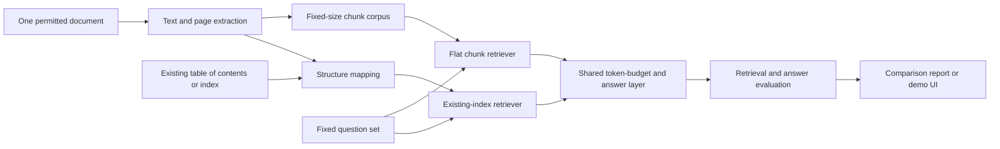

# AutoSTAIR — Project Plan

**Status:** Draft for review  
**Project type:** Open-source portfolio experiment and demo  
**Working title:** AutoSTAIR  
**Research inspiration:** IBM's STAIR paper and its SearchTome benchmark

## 1. Executive summary

AutoSTAIR will run a small, controlled benchmark to test whether Retrieval-Augmented Generation (RAG) works better when retrieval uses a document's **existing index or table of contents** than when the same document is split into ordinary fixed-size chunks.

The first version will use one carefully selected document, or a smaller subset if the benchmark makes that practical. The document must already have a usable table of contents, index, or section structure. We will preserve and use that structure; we will not ask an AI model to create an index of paragraphs, infer a hierarchy, or label the document for us.

The project will compare two retrieval paths over the same content and question set:

1. **Flat chunk retrieval:** split the document into fixed-size text chunks and retrieve the best-matching chunks.
2. **Existing-index retrieval:** use the document's supplied section/index structure to locate relevant sections, then retrieve source text from those sections.

Both paths will feed the same answer-generation model and prompt under the same retrieval/context budget. We will measure retrieval quality and generated-answer quality separately. The goal is a small, transparent experiment that can be run with limited compute and that shows where using an existing index helps, where it does not, and what the trade-offs are.

AutoSTAIR is inspired by STAIR, but it is not intended to reproduce the paper's model training. STAIR fine-tunes a model to predict leaf section names from a question and a supplied table of contents; AutoSTAIR will benchmark two practical RAG retrieval strategies on a constrained resource budget.

## 2. Problem and motivation

Many long documents already have a useful structure: a table of contents, numbered sections, or an index. A conventional RAG pipeline often splits the document into equal-sized chunks and searches those chunks without preserving much of their original organization.

That creates a testable question: **does using an existing document index help a RAG system find better evidence than flat chunking?** This is narrower and more measurable than trying to build a general RAG platform. It also avoids spending project resources on training a model or generating a new index.

This distinction matters: the project tests the value of **using a supplied structure**, not the quality of an AI-generated structure.

## 3. Research questions

### Primary question

For one long, already-indexed document, does retrieval organized around the existing index improve evidence retrieval and answer quality compared with fixed-size chunk retrieval?

### Secondary questions

- Does the index-aware method retrieve the correct source section more often at top-k?
- Does the retrieved evidence support the final answer more reliably?
- Does either method require more tokens, time, or model calls?
- Which question types benefit from the existing index, and which do not?
- Do conclusions change when retrieval context is held to the same token budget?

## 4. Hypotheses to test

These are hypotheses, not assumed outcomes:

- **H1:** Index-aware retrieval will improve retrieval of the gold section for questions whose wording differs from the source paragraph but aligns with the section topic.
- **H2:** Index-aware retrieval may help questions that depend on section context, but could be less precise when a relevant section is long or broadly titled.
- **H3:** Any retrieval advantage may disappear or shrink when both methods receive the same amount of retrieved text.
- **H4:** Better retrieval should usually improve grounded answer quality, but retrieval gains will not guarantee a better generated answer.

## 5. Scope boundaries

### In scope

- One primary document with an existing, usable table of contents or index.
- A small, fixed question set with human-checked target evidence locations.
- A fixed-size chunk RAG baseline.
- A retrieval approach that uses the document's existing section/index structure.
- A controlled comparison using the same answer model, generation prompt, question set, and context budget.
- Retrieval and answer-quality metrics, cost/latency tracking, qualitative error analysis, and a small inspection UI or report.
- Reproducible configuration and a public demo using data that may be redistributed or accessed by setup instructions.

### Explicitly out of scope

- Asking an AI model to create an index of paragraphs.
- Automatically inferring a hierarchy or generating section labels/summaries for the benchmark document.
- Fine-tuning a language model to reproduce STAIR.
- Training a model from scratch or maintaining a multi-document production search service.
- Claiming that structure-aware retrieval is universally better based on one document.
- Treating an LLM judge score as ground truth.

## 6. Dataset and document choice

### Selected document

The first case study uses the World Bank's *World Development Report 2024: The
Middle-Income Trap*. The official full report is 276 pages and has an authored,
machine-readable hierarchy covering its overview, three parts, eight chapters,
and detailed subsections. It is publicly available under CC BY 3.0 IGO.

This choice keeps the corpus to one document while providing enough neighboring
economic and policy topics to create a meaningful retrieval comparison. The
source PDF is not committed to Git; setup instructions point to the official
World Bank download and preserve the required attribution.

### Selection criteria

Choose one document that:

- Has a clear existing table of contents, index, or numbered section hierarchy.
- Has searchable text and stable page/section references.
- Is small enough to process and evaluate locally or with modest model/API use.
- Has a suitable license or access terms for the intended demo and repository.
- Covers enough distinct topics to support a useful range of questions.

The report has no project-ready gold question set, so AutoSTAIR will use a small
human-checked evaluation set with gold leaf-section identifiers and supporting
passages. Questions used to configure retrieval remain separate from the frozen
test set. Do not use the final test questions to select chunk sizes, top-k values,
prompts, or models.

### Question set

Prefer an existing question-answer or retrieval benchmark tied to the chosen document, if its question-to-section labels are available. If not, create a modest evaluation set by writing or reviewing questions and manually labeling the supporting section/page. Keep the initial set small enough for careful review; a target of roughly 50–100 questions is reasonable if suitable data and time permit.

For every question, store:

- Stable question ID and question text.
- Whether the question is answerable from the document.
- Gold section/page or acceptable evidence locations.
- A short reference answer or rubric, when answerable.
- Question type (for example: direct fact, paraphrase, section-level concept, multi-section synthesis, or unanswerable).
- Annotation notes and source references.

The test set must not be used to tune chunk size, retrieval settings, prompts, or model selection. If settings are tuned, use a separate development subset or a small pilot set and freeze the final configuration before measuring the test set.

## 7. Comparison design

### Arm A — Flat chunk RAG

1. Extract document text and source locations.
2. Split text into fixed-size chunks with a documented chunk size and overlap.
3. Index chunks with the chosen lexical and/or dense retrieval method.
4. Retrieve top-ranked chunks for each question.
5. Pass the selected evidence to the answer model within the shared context budget.

### Arm B — Existing-index RAG

1. Read the document's supplied table of contents/index and map its existing sections to source text and page ranges.
2. Preserve the original section names and hierarchy. Clean up formatting only as needed; do not ask an LLM to invent or relabel sections.
3. Retrieve candidate sections using a documented method, such as lexical or dense matching over the existing heading plus its source text.
4. Resolve selected sections to their source passages and pass text to the answer model within the same context budget as Arm A.

### Fairness controls

Keep these factors the same across both arms:

- Document version and extracted text.
- Question set and evaluation split.
- Retrieval model family where comparable, answer model, prompt, temperature, and answer-generation settings.
- Maximum number of retrieved items where appropriate.
- Maximum total evidence/context tokens.
- Hardware/provider and caching policy.
- Evaluation rubric and metric implementation.

Record differences that cannot be made identical, especially retrieval granularity, indexing time, and any model calls used by the retrieval layer. Report those differences instead of hiding them.

### Optional diagnostic conditions

Only add these if they fit the time and compute budget:

- Heading text included versus omitted in the index-aware representation.
- Section-only retrieval versus section retrieval with a small amount of neighboring/parent context.
- BM25 versus dense retrieval within each arm.
- A no-retrieval or full-document-context diagnostic for a very small question subset.

These are diagnostic ablations; the primary two-arm comparison remains the project headline.

## 8. Evaluation plan

### Retrieval quality

- **Recall@1:** whether the first result points to an acceptable gold section/evidence location.
- **Recall@k / Hit@k:** whether at least one acceptable location appears in the top k.
- **MRR:** how highly the first acceptable result is ranked.
- **nDCG@k:** use when questions can have multiple graded relevant sections.
- **Evidence coverage:** whether the selected context contains the annotated supporting passage.

### Generated-answer quality

Evaluate separately from retrieval. For a small test set, use a human-reviewed rubric covering:

- **Answer correctness:** does the response answer the question according to the source and reference rubric?
- **Faithfulness/support:** are the factual claims supported by retrieved evidence?
- **Citation correctness:** do citations point to the right section/page and support the cited claim?
- **Abstention:** for unanswerable questions, does the system say the source lacks enough evidence instead of inventing an answer?

An automated judge may be included as a secondary, clearly labeled aid. It must not replace source checking or be reported as the only answer-quality result.

### Efficiency and resource use

- Retrieval latency and end-to-end latency (median and p95 where enough runs exist).
- Number of model/API calls and prompt/completion tokens.
- Embedding/index construction time and storage size if dense indexing is used.
- Approximate API/compute cost for the fixed evaluation run.

### Error analysis

Review representative cases from both methods:

- Both methods correct.
- Chunk method correct, index-aware method wrong.
- Index-aware method correct, chunk method wrong.
- Both methods wrong.
- Question is unanswerable or ambiguous.

Classify likely causes such as vocabulary mismatch, overly broad section titles, long sections, missing extraction text, question ambiguity, insufficient context, or answer-model error. Include examples in the final report.

## 9. Product/demo experience

The demo should help a viewer understand the experiment quickly, not turn into a general-purpose document-chat product.

A user should be able to:

1. Select a prepared document and a retrieval method, or choose a side-by-side comparison.
2. Ask a question or run the fixed evaluation set.
3. See the answer and citations to source pages/sections.
4. Inspect retrieved evidence and the path through the existing table of contents.
5. Compare the two methods' ranked evidence, answer, metrics, latency, and token use.
6. Open a small results view showing aggregate and per-question outcomes.

The interface should make the source evidence visible so the audience can judge whether retrieval found the right place. The demo should clearly say it tests one document and does not establish universal performance.

## 10. System components

### A. Document and structure loader

- Read the chosen document and its existing outline/index.
- Normalize text and preserve source page/section references.
- Create a stable section tree or table mapping from supplied headings to text ranges.
- Validate missing, duplicate, or unmapped sections and report issues.
- No generative model in this component.

### B. Chunk builder

- Create fixed-size chunks for the baseline.
- Preserve page and source offsets for citations.
- Make chunk size and overlap explicit configuration values.

### C. Retriever implementations

- Flat chunk retriever.
- Existing-index/section retriever.
- Shared interface for returning ranked evidence records with scores and source locations.
- Optional lexical/dense variants behind configuration, if resources allow.

### D. RAG answer service

- Receive question and retrieved evidence.
- Use one fixed answer prompt and answer model for both arms.
- Require citations to retrieved source identifiers.
- Support a clear “not enough evidence in this document” response.
- Keep answer generation independent from retrieval scoring.

### E. Evaluation runner

- Load question records and frozen experiment configuration.
- Run both arms on the same questions.
- Compute retrieval metrics and save raw rankings, timings, tokens, and answer outputs.
- Export results to CSV/JSON for reproducibility and charts.

### F. Review UI or report

- Show the question, output, citations, evidence text, and outline location.
- Display side-by-side method results and aggregate metrics.
- Include known limitations and data source details.

## 11. Suggested architecture



Keep the evaluation and retrieval code runnable without the UI. A lightweight Python implementation is likely sufficient; add a small web interface only after the benchmark produces reliable results. Use a local embedding model or low-cost provider only if it fits available hardware and budget. The chosen model and settings must be pinned and recorded.

## 12. Proposed repository layout

```text
AutoSTAIR/
  README.md
  PROJECT_PLAN.md
  docs/
    methodology.md
    data-and-licensing.md
    results.md
  configs/
    baseline.yaml
  data/
    README.md          # acquisition instructions; no restricted data
  src/autostair/
    document_loader.py
    structure_loader.py
    chunking.py
    retrievers/
      base.py
      flat_chunk.py
      indexed_section.py
    rag.py
    evaluation/
      metrics.py
      runner.py
  app/                  # optional small comparison UI
  results/              # compact tables/plots, no restricted source text
```

The initial plan does not require every module or directory to exist at once. Start with the benchmark runner and two retrieval arms; add the UI when the comparison is stable.

## 13. Build sequence

1. **Choose and verify the document.** Confirm it has a usable existing index, accessible text, stable page/section locations, and acceptable reuse terms.
2. **Freeze the question set.** Locate existing questions and labels or prepare a small human-reviewed set. Define answerable/unanswerable cases and gold evidence locations.
3. **Build ingestion and source mapping.** Load text and supplied outline without LLM-generated indexing. Inspect a sample of mappings manually.
4. **Implement flat chunk retrieval.** Start with one reproducible retriever and a documented chunking configuration.
5. **Implement existing-index retrieval.** Use the original headings and map selected sections back to source passages.
6. **Run retrieval-only comparisons.** Confirm metric code and inspect raw rankings before introducing answer generation.
7. **Add the shared answer layer.** Use the same answer model, prompt, and evidence token budget for both methods.
8. **Evaluate and analyze failures.** Freeze settings, run the test set, calculate metrics and resource use, and review representative disagreements.
9. **Build the small demo/report.** Display evidence, citations, structure path, and comparative results.
10. **Publish reproducibly.** Document setup, data acquisition, exact configurations, measured results, caveats, and a short demo video.

## 14. Definition of done

- One selected document and its existing index are documented with source and license/access details.
- The data path uses the supplied index/structure; no model generates paragraph indexes or a new hierarchy.
- Flat chunk retrieval and existing-index retrieval both run on the same fixed question set.
- The answer model, prompt, and evidence token budget are controlled across arms.
- Retrieval metrics and answer-quality results are reported separately.
- Latency, token use, and approximate cost are recorded.
- At least several method disagreements and failures are inspected and explained.
- Results can be reproduced from code and documented data setup without exposing restricted content or private credentials.
- The README and demo state clearly that findings apply to this small experiment and are not a universal claim about RAG.

## 15. Risks and safeguards

| Risk | Response |
|---|---|
| Only one document limits generalization | Frame conclusions as a controlled case study; avoid broad claims. |
| Index and chunks have different retrieval granularity | Use a shared evidence token budget; report retrieved text length and granularity. |
| Existing headings may be poorly mapped to text | Validate mappings manually and log extraction failures. |
| Question set may favor one method | Use existing benchmark labels where appropriate; otherwise label questions before comparing methods and keep a held-out test subset. |
| Generated answers obscure retrieval quality | Report retrieval metrics separately and inspect the retrieved evidence directly. |
| LLM judge may be unreliable | Use human review for a small sample and treat judge scores as secondary. |
| Source text or benchmark license may restrict redistribution | Keep restricted data out of Git; document approved acquisition steps and use a small permitted demo fixture. |
| Model/API budget is limited | Cache embeddings and responses where valid, use a small evaluation set, and record all calls and costs. |

## 16. Relationship to the STAIR paper

The STAIR paper proposes a model-based retriever that receives a question plus a document's full table of contents and predicts the most relevant leaf section. It also introduces SearchTome, a benchmark made from 18 books across six domains. The paper reports Recall@1 of 82.6% for STAIR and 76.9% for fine-tuned DSI on its benchmark.

AutoSTAIR will use that paper as motivation for asking whether existing document structure improves retrieval. It will not claim to reproduce STAIR's fine-tuning method or results. The project deliberately focuses on a resource-light comparison of two RAG retrieval layouts over one or fewer documents. Automatic hierarchy creation is excluded.

Reference: Kumar et al., [STAIR: A novel dataset and LLM based retriever for document structure augmentation](https://arxiv.org/abs/2609.03874), 2026.

## 17. Portfolio presentation

The portfolio story is: **I ran a controlled, inspectable experiment on whether an existing document index improves RAG retrieval compared with chunking.** Show the selected source, the two retrieval paths, identical query/context conditions, measured results, failure examples, and limits.

Suggested public artifacts:

- Open-source code and reproducible experiment configuration.
- A concise architecture diagram and methodology note.
- A results page or small side-by-side demo.
- A 60–90 second video showing one question where the methods differ and how the evidence supports the result.
- A LinkedIn post summarizing the finding with the one-document limitation clearly stated.
